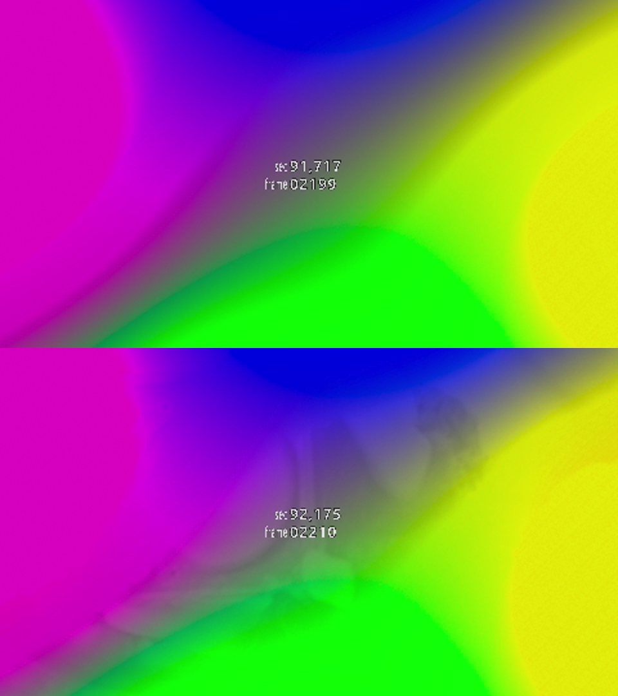
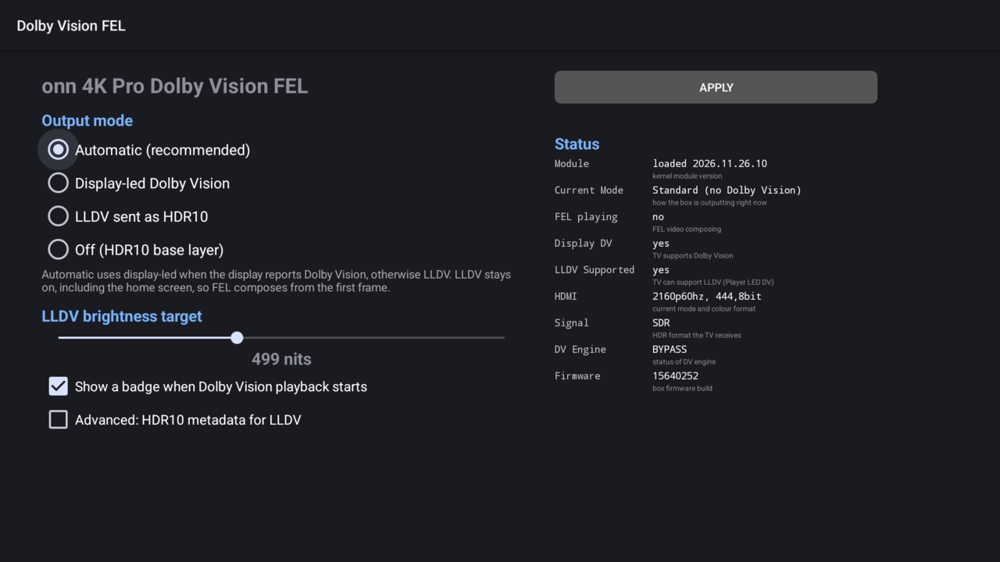
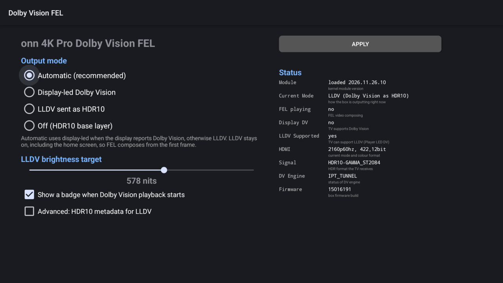
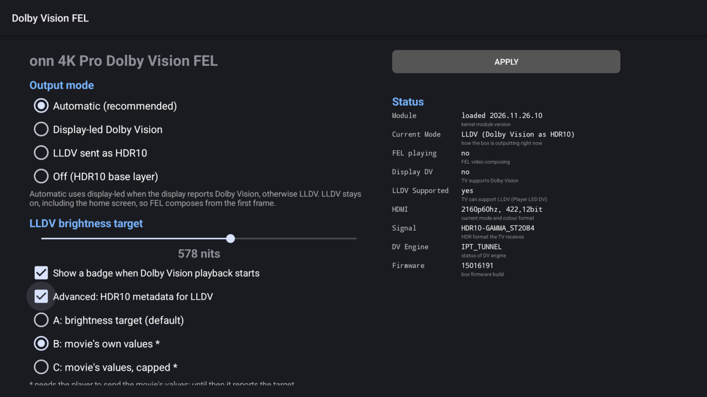
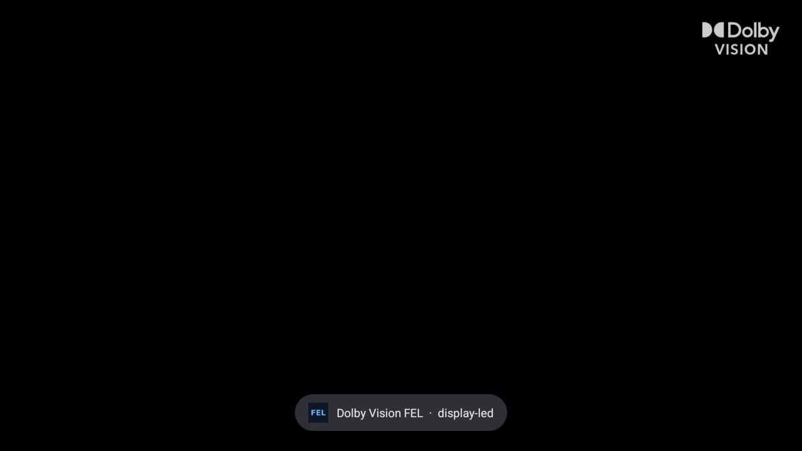

# onn 4K Pro Dolby Vision FEL

**Full Enhancement Layer Dolby Vision on the onn 4K Pro (2nd gen).** A Magisk module that makes the
box's Dolby Vision hardware compose profile 7 FEL video (base layer + enhancement layer), as UHD
Blu-ray remuxes are mastered, instead of throwing the enhancement layer away. It also adds
**LLDV ("Player-led" Dolby Vision sent as HDR10)** so TVs without Dolby Vision get the
Dolby Vision tone-mapped picture too.

Everything runs in memory. Nothing on the box's partitions is changed: uninstall the module and
reboot, and the box is stock again.

**Latest release: 2026.11.26.11** (smooth 24 Hz FEL on Dolby Vision TVs and LLDV, badge for every Dolby Vision video):
[download `onn-dvfel-magisk-2026.11.26.11.zip`](https://github.com/kushmint/ONN4k-Dolby-Vision-FEL/releases/download/v2026.11.26.11/onn-dvfel-magisk-2026.11.26.11.zip)
· [all releases](https://github.com/kushmint/ONN4k-Dolby-Vision-FEL/releases) · [install guide](#install)
· [changelog](#changelog)
· FEL players: [ONN4k-FEL-Players v2026.11.26](https://github.com/kushmint/ONN4k-FEL-Players/releases/tag/v2026.11.26)
(use these together: smooth 24 Hz needs module 2026.11.26.10 or later **and** players v2026.11.26 or later)

> **Smooth FEL playback.** FEL movies now play at 24 Hz with every frame shown once, with its
> enhancement layer: no repeated frames, no dropped frames and no green flashes, on Dolby Vision TVs
> (display-led) and on HDR10 TVs (LLDV). On a Dolby Vision TV, 5 minutes of a UHD Blu-ray FEL remux
> streamed over the network in Kodi FEL used to lose 45 frames; it now loses none after the first
> seconds of buffering. See [Tested](#tested).



*Same moment of the "DV FEL All Layers Test" clip, captured from the box's video output.
Top: stock (base layer only). Bottom: with this module, the shapes that exist only in the
enhancement layer appear.*

---

## Contents

- [What you need](#what-you-need)
- [Install](#install)
- [Tested](#tested)
- [Changelog](#changelog)
- [Output modes: which one is for you](#output-modes-which-one-is-for-you)
- [The settings app](#the-settings-app)
- [Players](#players)
- [Command line](#command-line)
- [How it works](#how-it-works)
- [Known issues](#known-issues)
- [Building from source](#building-from-source)
- [Credits and license](#credits-and-license)

---

## What you need

| | |
|---|---|
| **Box** | onn 4K Pro, 2nd generation (`jarvis2`, Amlogic S905X5M, Android TV 14) |
| **Firmware** | `15016191` (Canada, URO3.260203.009.A2) or `15640252` (US, URO3.260203.035.A1). Any other build is refused at install and at load. |
| **Root** | Magisk (tested with 30.7) |
| **Player** | A FEL-aware player that feeds the enhancement layer to the module: VLC FEL or Kodi FEL from [ONN4k-FEL-Players](https://github.com/kushmint/ONN4k-FEL-Players). See [Players](#players). |
| **Display** | A Dolby Vision TV (display-led), **or** an HDR10 TV / AVR chain that accepts 4:2:2 12-bit (LLDV). |

Check your firmware build: **Settings → System → About → Android TV OS build**, or
`adb shell getprop ro.build.version.incremental`.

## Install

### 1. Download the zip

**[onn-dvfel-magisk-2026.11.26.11.zip](https://github.com/kushmint/ONN4k-Dolby-Vision-FEL/releases/download/v2026.11.26.11/onn-dvfel-magisk-2026.11.26.11.zip)**
(newer versions: [Releases](https://github.com/kushmint/ONN4k-Dolby-Vision-FEL/releases)).

It's a standard Magisk module zip (about 85 KB). Don't unzip it; Magisk installs it as is. Inside:

| File | What it is |
|---|---|
| `dvfel.ko` | The kernel module that pairs and composes the enhancement layer (built for the onn's exact kernel, CFI-enabled) |
| `service.sh` | Loads `dvfel.ko` at every boot (after checking the firmware), then applies your settings |
| `dvfelctl`, `lldv_setup.sh` | The root service behind the settings app (output mode, LLDV, sleep/wake handling) |
| `system.prop` | Display timing and video decoder buffer properties for smooth 24 Hz FEL playback (see [How it works](#how-it-works)) |
| `system/app/DvfelSettings` | The **Dolby Vision FEL** settings app |
| `customize.sh` | Install-time check: refuses any firmware other than the two supported builds |

### 2. Install it

Use **one** of the two ways below. Whichever you pick, the installer checks your
firmware and stops if it isn't supported.

#### Option A: USB stick (no computer needed)

1. Copy the zip to a USB stick (FAT32 or exFAT) and plug it into the onn box.
2. Open the **Magisk** app → **Modules** tab → **Install from storage**.
3. In the file picker, open the menu (☰), choose your USB drive, and select the zip.
4. Wait for **Done**, then press **Reboot**.

If the USB drive doesn't appear in the picker, copy the zip to the box's **Download** folder first
with a file manager (for example *File Commander* or *X-plore*), then pick it from **Downloads**.

#### Option B: ADB from a computer

One-time setup on the box: **Settings → System → About**, select **Android TV OS build** seven times
to unlock **Developer options**, then in **Settings → System → Developer options** turn on
**USB debugging**. Note the box's IP address (**Settings → Network & Internet**, select your network).

On the computer ([platform-tools](https://developer.android.com/tools/releases/platform-tools)):

```sh
# download the zip (or use the link above in a browser)
curl -LO https://github.com/kushmint/ONN4k-Dolby-Vision-FEL/releases/download/v2026.11.26.11/onn-dvfel-magisk-2026.11.26.11.zip

adb connect <box-ip>:5555        # on the TV: tick "Always allow from this computer", then Allow
adb push onn-dvfel-magisk-2026.11.26.11.zip /sdcard/Download/
```

Then either install it from the **Magisk** app (**Modules → Install from storage → Downloads**), or
straight from the command line:

```sh
adb shell "su -c 'magisk --install-module /sdcard/Download/onn-dvfel-magisk-2026.11.26.11.zip'"
adb reboot
```

The first `su` from ADB makes Magisk ask on the TV whether to grant **Shell** root: allow it.
After `adb reboot`, run `adb connect <box-ip>:5555` again before any further `adb` commands.

To install the players over ADB as well (from [ONN4k-FEL-Players](https://github.com/kushmint/ONN4k-FEL-Players/releases)):

```sh
adb install -r VLC-onn.apk
adb install -r Kodi-onn.apk
adb shell appops set org.xbmc.kodi.fel MANAGE_EXTERNAL_STORAGE allow   # Kodi: file access, after install or reboot
```

Open VLC once from the apps row and step through its welcome screens before playing anything.

### 3. After the reboot

Open **Dolby Vision FEL** from the apps row (or **Settings → Apps**). The default, **Automatic**, is
right for almost everyone. Press **Apply** if you change anything; the status panel should show
**Module: loaded** with the version you installed.

**Update:** install the new zip the same way, over the old one, and reboot. **Uninstall:** Magisk →
**Modules** → **Remove** on *onn 4K Pro Dolby Vision FEL*, then reboot. Your settings live in
`/data/adb/onn_dvfel/` and survive updates.

## Tested

**2026.11.26.10** (the same kernel module as 2026.11.26.11) with the players' v2026.11.26 builds, on both boxes. "Lost" is frames the video path never
showed; "held" is frames that had to wait for their enhancement layer (each one is a frame shown
twice); "green" is frames shown without their enhancement layer.

**US box → Dolby Vision TV (display-led), Kodi FEL, 24 Hz:**

| Test | Before (decoder margin 12) | **2026.11.26.10** |
|---|---|---|
| Full UHD Blu-ray FEL remux over SMB, 150 s, two runs | 176 / 89 held, 45 / 8 lost | **0 / 1 held, 0 / 0 lost, no green** |
| Same movie over SMB, 5 minutes | | **0 lost after the first 20 s of buffering, no green** |
| 60 s FEL clip from the box's storage, two runs | 5 lost per minute | **0 held, 0 lost, no green** |
| VLC FEL, 23.976 Hz | 29 held, 23 lost | **7 held, about 0 lost, no green** |

The previous public release (2026.11.20.16) lost about 0.3 frames per second here (one every 3 s).

**Canada box → AVR → HDR10 TV without Dolby Vision (LLDV), Kodi FEL, 24 Hz:**

| Test | Result |
|---|---|
| Full UHD Blu-ray FEL remux over SMB, 5 minutes | **0 lost, 2 held, no green** |
| 60 s FEL clip, several runs | 0 lost, 0–1 held, no green |

Also checked with 2026.11.26.10: Netflix and YouTube in 4K on both boxes (play normally; they use the AV1/VP9
decoders, which the buffer change doesn't touch), a profile 8.1 clip and a plain HDR10 clip (play
the same as before), MEL and UHD Blu-ray ISO playback, the badge for profile 7 FEL, profile 8 and
HDR10 (no badge), and no kernel faults in any run.

Results of the earlier release, for comparison:

Release 2026.11.20.15 on both supported firmware builds, with a real P7 FEL movie and the
"DV FEL All Layers Test" clip. "Lost" counts frames the display dropped during 30 s of normal
playback (seeks excluded).

| Box | Output | Player | Result |
|---|---|---|---|
| Canada (15016191) → AVR → HDR10 TV without Dolby Vision | LLDV (4:2:2 12-bit, HDR10) | VLC FEL, 60 Hz | Every frame with its enhancement layer, 0 lost |
| | | Kodi FEL, switches to 24 Hz | Every frame with its enhancement layer, ~0.15 lost per second |
| | | Test player, All Layers Test | Enhancement-layer detail present in every capture |
| US (15640252) → Dolby Vision TV | Display-led Dolby Vision | VLC FEL, 60 Hz | 702 frames paired, all with their enhancement layer, 0 lost |
| | | Kodi FEL, switches to 24 Hz | 693 frames paired, all with their enhancement layer, 0.3 lost per second |
| | | Test player, All Layers Test | Enhancement-layer detail present in every capture |

Also checked: stopping a FEL video leaves the next video clean, the menus look the same after
switching LLDV off, and no kernel faults in any run. (Killing a player mid-video is a different
case; see [Known issues](#known-issues).)

## Output modes: which one is for you

| Mode | What the TV gets | Use it when |
|---|---|---|
| **Automatic** (recommended) | Display-led if the TV reports Dolby Vision, otherwise LLDV if the TV/AVR accepts it, otherwise Off | Always, unless you have a reason not to |
| **Display-led Dolby Vision** | Real Dolby Vision; the TV does the tone mapping | Dolby Vision TVs |
| **LLDV sent as HDR10** | Dolby Vision processed on the box, tone-mapped to your brightness target, sent as HDR10 (4:2:2 12-bit) | HDR10 TVs without Dolby Vision. Matches CoreELEC's *"Player Led (DV as HDR10 422 12 Bit)"* |
| **Off** | Stock output; FEL videos play as their HDR10 base layer | Troubleshooting, or to compare |

### About LLDV

- With LLDV on, the whole box (home screen included) is sent as HDR10, so FEL composes from the
  very first frame of a video. The menus look the same as in SDR (menu white is about 260–270 nits)
  but your TV switches to its HDR picture mode, so its HDR picture settings apply.
- The box tone-maps the movie to the **LLDV brightness target**. Pick the value closest to what
  your TV can really reach: 320, 372, 499, 578, 775 or 1037 nits.
- Switching LLDV on or off changes the HDMI format, so the screen blanks twice for a few seconds.
- LLDV is only offered when your TV (and AVR, if any) reports 4:2:2 12-bit and HDR10 support.
  4:2:2 12-bit is the only low-latency format the box's driver allows.

## The settings app

The app needs no root grant: it hands your choice to the module's root service, which checks it
and applies it within a second or two. Open it from the apps row: **Dolby Vision FEL**.

**On a Dolby Vision TV** (Automatic → display-led; the box idles in bypass until a FEL video plays):



**On an HDR10 TV without Dolby Vision** (Automatic → LLDV at 578 nits: the whole box runs as HDR10 4:2:2 12-bit):



**Advanced: HDR10 metadata for LLDV** opened (choices A, B and C below the checkbox):



**The badge:** with *Show a badge when Dolby Vision playback starts* on, a message like this appears
for a few seconds when any Dolby Vision video starts, naming its profile (for example
*Dolby Vision Profile 7 FEL · LLDV 578 nits · sent as HDR10*, *Dolby Vision Profile 8*, or
*Profile 7 MEL*). A FEL video in a player that can't do FEL says *base layer only*. The screenshot
below is from an older version and shows the old wording (screenshots can't capture the video plane, so the movie shows as black here):



### Controls

| Control | What it does |
|---|---|
| **Output mode** | See [Output modes](#output-modes-which-one-is-for-you). |
| **LLDV brightness target** | Peak brightness the box tone-maps to in LLDV (320–1037 nits). Only used by Automatic (when it picks LLDV) and LLDV. |
| **Show a badge when Dolby Vision playback starts** | A short on-screen message when a Dolby Vision video starts: its profile (FEL / MEL for profile 7) and the output in use. |
| **Advanced: HDR10 metadata for LLDV** | What the HDR10 signal tells the TV in LLDV. **A** (default): your brightness target. **B**: the movie's own mastering values. **C**: the movie's values, capped at your target. B and C need a player that passes the movie's values; until then they report the target. |
| **Apply** | Saves and applies. It turns dark yellow when selected; "Applied." appears when the module confirms. |

### Status

| Row | Meaning |
|---|---|
| **Module** | dvfel kernel module version running on the box (`NOT LOADED` means it failed; see the log). |
| **Current Mode** | What the box is outputting right now: *Standard (no Dolby Vision)*, *LLDV (Dolby Vision as HDR10)*, *Display-led Dolby Vision* or *HDR10 only (FEL off)*. |
| **FEL playing** | *yes* while a FEL video is being composed. |
| **Display DV** | Your TV reports Dolby Vision support. |
| **LLDV Supported** | Your TV/AVR accepts what LLDV needs (4:2:2 12-bit + HDR10). This is a capability, not the current signal. |
| **HDMI** | Current resolution, refresh rate, colour format and bit depth (for example `2160p60hz, 422,12bit`). |
| **Signal** | HDR format the TV receives: `SDR`, `HDR10-GAMMA_ST2084` or `DolbyVision-Std`. |
| **DV Engine** | State of the box's Dolby Vision engine: `off`/`BYPASS` when idle, `IPT_TUNNEL` while LLDV or display-led runs. |
| **Firmware** | Box firmware build the module matched. |

## Players

A normal player (Netflix, Plex, stock ExoPlayer) only decodes the base layer, so FEL needs a
player that also decodes the enhancement layer and hands it to this module through `/dev/dvfel`.

Use the onn builds of signde's **VLC FEL** and **Kodi FEL** players from
**[ONN4k-FEL-Players](https://github.com/kushmint/ONN4k-FEL-Players/releases)**, v2026.11.26 or later (`VLC-onn.apk`,
`Kodi-onn.apk`). They install next to the stock VLC and Kodi (`org.videolan.vlc.fel`,
`org.xbmc.kodi.fel`). Install commands are under [Option B](#option-b-adb-from-a-computer).

| Player | Notes |
|---|---|
| **VLC FEL** | Plays at the current refresh rate (no automatic 24 Hz switch). Open it once and finish its welcome screens before the first video. |
| **Kodi FEL** | Switches the TV to the movie's frame rate (23.976/24 Hz) when Kodi's *Adjust display refresh rate* is on, which is the default in this build. Kodi checks this module's display timing property: with an older module it stays at the current refresh rate while FEL plays. |

The onn changes to the players (S7D board support, the Codec2 enhancement-layer decoder, timing
fixes) are being offered upstream to [signde/vlc-fel-android](https://github.com/signde/vlc-fel-android).

The [settings app](#the-settings-app) shows **FEL playing: yes** while a FEL video is composed, and
with the badge on, a short message names the Dolby Vision profile when a video starts.

Videos that aren't profile 7 FEL (MEL, profile 5/8, HDR10, SDR) are not changed by the module, except
that every HEVC video decoder gets the larger buffer margin described under [How it works](#how-it-works).

## Command line

Everything the app does is also available as root:

```sh
su -c sh /data/adb/modules/onn_dvfel/dvfelctl status          # current state (same as the app's status)
su -c sh /data/adb/modules/onn_dvfel/dvfelctl set MODE=lldv NITS=578
su -c sh /data/adb/modules/onn_dvfel/dvfelctl apply
```

Settings (`/data/adb/onn_dvfel/settings.conf`): `MODE=auto|displayled|lldv|off`,
`NITS=320|372|499|578|775|1037`, `META=A|B|C`, `BADGE=0|1`.
Log: `/data/adb/onn_dvfel/log.txt`. Driver counters: `/sys/kernel/debug/dvfel/stats`
(`composer 0` = FEL composing, `bl paired` = frames with their enhancement layer).

## How it works

![Diagram: the FEL player decodes the base layer with the Dolby Vision decoder and the enhancement layer with a second HEVC decoder. Base-layer frames go through the normal Android video path; enhancement-layer frames go to dvfel.ko through /dev/dvfel. dvfel pairs each base-layer frame with its enhancement layer and the SoC's Dolby Vision core composes both, then sends display-led Dolby Vision to a Dolby Vision TV or LLDV as HDR10 to an HDR10 TV. The settings app controls the output through dvfelctl.](docs/how-it-works.svg)

1. The player decodes the base layer with the normal Dolby Vision decoder and the enhancement
   layer with a second HEVC decoder, then queues each EL frame with its RPU checksum on `/dev/dvfel`.
2. The module registers as a video provider (`dveldec`) and uses kprobes on the box's own
   `aml_media` driver to pair every base-layer frame with its enhancement layer by timestamp and
   RPU checksum.
3. The box's Dolby Vision core then composes both layers in hardware. A few hooks keep the
   composer in FEL mode for the whole video and stop the Dolby library from rejecting the residual.
4. For LLDV, the module presents a low-latency Dolby Vision sink at your brightness target to the
   driver, keeps the HDMI link at 4:2:2 12-bit, and replaces the Dolby Vision signalling with HDR10.

5. The module also sets one Android display property at boot (in memory, via Magisk's
   `system.prop`): `debug.sf.early_gl_phase_offset_ns=4000000`. With the vendor's 1 ms,
   SurfaceFlinger woke before a FEL frame's present fence had signalled, which at 24 Hz made it
   skip a vsync and drop frames (Kodi FEL lost 7–10 per second). 4 ms is the vendor's own normal
   offset and the smallest value that fixes it without costing UI smoothness.

6. It also gives the video decoders more output buffers: `vendor.media.c2.vdec.margin=20`
   (stock 6) and `debug.dvfp.sc2_buffers=11` (how many enhancement-layer frames the FEL players may
   keep in flight). With fewer buffers (12 stock, 18 in test builds) the enhancement-layer decoder ran out at
   every keyframe (about once a second), the enhancement layer arrived late, and the frame had to
   wait for it: shown twice, and at 24 Hz a dropped frame. With 26 buffers it stays well ahead. The
   margin applies to every app's HEVC decoder; Netflix and YouTube use AV1/VP9 decoders, which
   keep their own.

7. When an enhancement layer is late anyway, the frame waits for it (up to 150 ms, 500 ms in the
   first seconds of a video) instead of going out without it, which would show green.

Each firmware build has its own verified profile of addresses and instruction checks. If anything
doesn't match, the module refuses to load instead of guessing.

## Known issues

- **Updating needs a reboot.** After a FEL video has played, one frame stays referenced, so the
  module can't be unloaded; the zip update is applied on reboot anyway.
- **A short green flash can appear when you stop a FEL video.**
- **Killing a FEL player mid-video** (force stop, or Android killing it) can leave the next one to
  three videos green or garbled, even non-Dolby Vision ones; it clears by itself. It also happens
  with the plain HEVC decoder, so it looks like the box's decoder teardown with two decoders in a
  dying app rather than this module. Stopping a video normally is not affected.
- **AVRs and HDMI handshakes:** an LLDV switch changes the HDMI format twice. One AVR once kept
  renegotiating HDCP afterwards (no picture). Changing the resolution or refresh rate once fixes it.
- **The first seconds of a video streamed over the network** can drop a few frames while the player
  buffers. A seek costs about 3–4 frames.

## Changelog

### 2026.11.26.11
- Settings app: removed the experimental *LLDV only while a FEL video plays* option (FEL never
  composed with it). Anyone who had it on is moved to the normal behaviour (LLDV stays on). New app
  screenshots. The kernel module is unchanged from 2026.11.26.10 (the app's status still shows
  `2026.11.26.10`).

### 2026.11.26.10
- **Smooth 24 Hz FEL on Dolby Vision TVs and LLDV.** Video decoder buffer margin 20 (was the stock 6),
  so the enhancement layer is never late at keyframes. On a Dolby Vision TV a 150 s network play lost
  45 frames before and none now.
- **Lighter hook on the Dolby Vision core's register writes.** The module now hooks only the code
  paths that write the registers it changes, instead of every one of about 1,450 writes per frame. The
  display interrupt is about 1.5 ms shorter, which removed most of the dropped frames on Dolby Vision
  TVs (display-led).
- **No green frames when an enhancement layer is late:** the frame waits up to 150 ms for it (was 50 ms),
  and up to 500 ms in the first 6 seconds of a video.
- **Badge for every Dolby Vision video**, naming the profile and FEL or MEL (for example *Dolby Vision
  Profile 7 FEL · LLDV 578 nits · sent as HDR10*, *Dolby Vision Profile 8*). FEL in a player that can't
  do FEL says *base layer only*.
- **Safer updates:** if a new `dvfel.ko` is refused at boot, the module loads the last version that
  worked on that box.
- **Fixed: green or snowy video after a FEL video.** The next non-FEL video (any player, even the home
  screen preview) could show green snow until a reboot.
- `/sys/kernel/debug/dvfel/holds`: one line per frame that waited for its enhancement layer (for
  troubleshooting).

### 2026.11.20.16
- Credits for djnice; README screenshots and diagram. Same code as 2026.11.20.15.

### 2026.11.20.15
- First public release: FEL composition, LLDV for HDR10 TVs, the settings app, the SurfaceFlinger
  timing fix for Kodi FEL at 24 Hz, and the fixes for green video after stopping a FEL video.

## Building from source

The prebuilt zip is what most people want. To build it yourself you need:

- The Android common kernel `android14-5.15` (KMI 11, build 14657224) in `kernel/common`, Amlogic
  `common_drivers` in `kernel/common_drivers`, configured in `kernel/out` with the box's config.
- Clang `r487747c` in `kernel/clang-r487747c`. The kernel enforces CFI: **a module built without
  CFI with this exact toolchain will panic the box.**
- `aml_media.ko` from each firmware's `vendor_boot` in `firmware/` (CA) and `firmware/us/` (US),
  used to check the driver's layout during the build.
- For the app: Android build-tools and platform in `player/sdk`, and `r8.jar` in `player/sdk/r8`.

```sh
bash kernel/tools/final_build.sh       # dist/dvfel.ko (exact symbol versions, verified)
bash player/build_settings_app.sh      # player/build/DvfelSettings.apk
bash magisk/build_module.sh            # dist/onn-dvfel-magisk-<version>.zip
```

`tests/` has the scripts used to verify FEL on real hardware: on-box `*_device.sh` scripts, and
`feldet.py` / `feldet_tunnel.py`, which score VDIN captures of the test clip for enhancement-layer
detail. Host scripts take the box address from `ONN_BOX=<ip>:5555`.

## Credits and license

**Huge thanks to [djnice](https://github.com/djnice).** FEL on Android TV boxes starts with his
work: the kernel module design, the FEL player and the library every one of these players runs on.
This project wouldn't exist without it.

- **[djnice](https://github.com/djnice)**: the original Android FEL work this all builds on: the `dvfel`
  kernel module design (written for the Dune HD S905X4: `dveldec` provider, base/enhancement-layer
  pairing by RPU checksum, composition by the SoC's Dolby Vision core), the original VLC FEL for
  Android ([djnice/vlc-fel-android](https://github.com/djnice/vlc-fel-android)) and libdvfelplay, the FEL
  library both players use (with **Team CoreELEC**).
- **[signde](https://github.com/signde)**: the Fire TV Cube 3 port of that module
  ([firetv-passthrough](https://github.com/signde/firetv-passthrough)), which this onn module is ported
  from, and the VLC FEL / Kodi FEL players the onn builds are based on.
- **[avdvplus](https://github.com/avdvplus)** (CoreELEC Dolby Vision builds): the reference design for
  LLDV. This module's LLDV follows avdvplus's *"Player Led (DV as HDR10 422 12 Bit)"*: a forced
  low-latency Dolby Vision sink at a brightness target, the HDMI link held at 4:2:2 12-bit across mode
  changes, and HDR10 signalling. avdvplus on CoreELEC was also the picture this port was tuned to match.
  No avdvplus code is included.
- **[quietvoid](https://github.com/quietvoid/dovi_tool)**: libdovi (dovi_tool), used by the players'
  FEL library and built into the test player.
- **[VideoLAN](https://www.videolan.org/) and [Team Kodi](https://kodi.tv/)**: VLC and Kodi, the players
  signde's FEL builds are based on.
- onn 4K Pro port, LLDV, Magisk module, settings app and the onn player builds: **kushmint**.

GPL-2.0-or-later. See [LICENSE](LICENSE) and [NOTICE.md](NOTICE.md). Not affiliated with Dolby,
onn or Amlogic.
